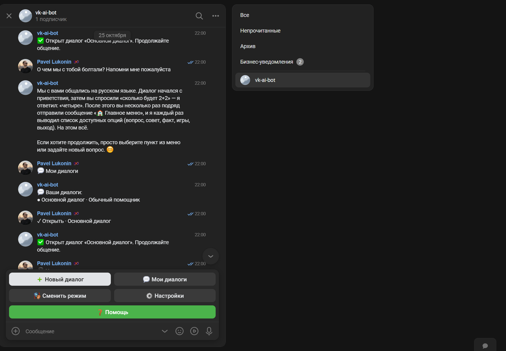
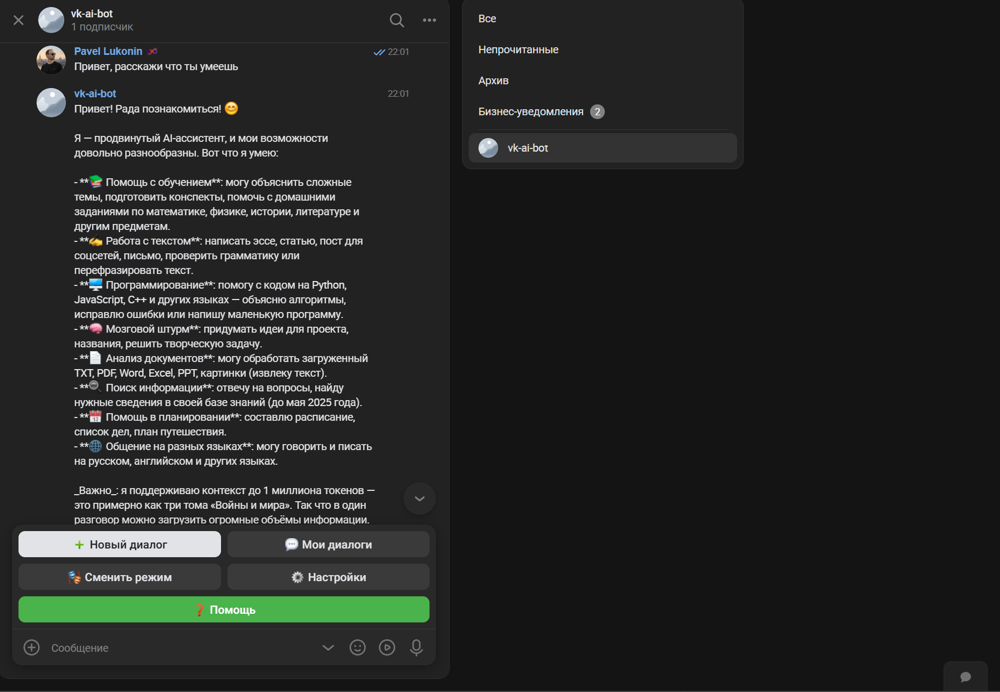

# LogicPulse VK AI Bot

Асинхронный AI-помощник для сообщества ВКонтакте, построенный на Python и
VKBottle. Бот поддерживает несколько независимых диалогов, сохраняет контекст
в JSON, переключает роли общения и работает с Cloud.ru Foundation Models через
OpenAI-совместимый API.

## Возможности

- несколько независимых диалогов для каждого пользователя;
- сохранение истории и активного диалога в отдельных JSON-файлах;
- создание, открытие, переименование и удаление диалогов;
- пять режимов общения: помощник, программист, преподаватель,
  бизнес-консультант и дружелюбный собеседник;
- очистка истории текущего диалога;
- индикация набора ответа во ВКонтакте;
- автоматическое разбиение длинных ответов;
- атомарная запись данных и восстановление после повреждённого JSON;
- автозапуск и перезапуск через systemd;
- изолированный системный пользователь `vkbot`.

## Интерфейс

### Диалоги и память



### Ответ AI-помощника



## Конфигурация модели

| Параметр | Значение по умолчанию |
| --- | --- |
| API | `https://foundation-models.api.cloud.ru/v1` |
| Модель | `deepseek-ai/DeepSeek-V4-Pro` |
| Temperature | `0.8` |
| Максимум токенов | `1000` |
| Сообщений в контексте | `20` |
| Сохранённых сообщений | `100` |
| Тайм-аут | `120` секунд |
| Уровень логирования | `INFO` |

Все параметры задаются через `.env`; секреты не хранятся в репозитории.

## Структура

```text
vk-ai-bot/
├── bot/                  # Обработчики сообщений VK
├── config/               # Настройки окружения
├── deploy/               # Установщик, systemd и проверка сервиса
├── keyboards/            # Клавиатуры ВКонтакте
├── models/               # Pydantic-модели данных
├── services/             # AI и управление диалогами
├── storage/              # Асинхронное JSON-хранилище
├── tests/                # Автоматические тесты
├── users/                # Локальные данные пользователей
├── utils/                # Логирование и обработка текста
├── main.py               # Точка входа
└── requirements.txt
```

## Локальный запуск

Требуется Python 3.10 или новее.

```bash
python3 -m venv .venv
.venv/bin/pip install -r requirements.txt
cp .env.example .env
```

Заполните в `.env`:

```dotenv
VK_TOKEN=токен_сообщества_ВКонтакте
OPENAI_API_KEY=ключ_Cloud.ru
```

Запустите:

```bash
.venv/bin/python main.py
```

## Развёртывание на Ubuntu

```bash
chmod +x deploy/install.sh deploy/check.sh
sudo ./deploy/install.sh
sudo nano /opt/vk-ai-bot/.env
sudo systemctl enable --now vk-ai-bot.service
sudo ./deploy/check.sh
```

После установки проект находится в `/opt/vk-ai-bot`, а пользовательские JSON
файлы — в `/opt/vk-ai-bot/users`. Сервис запускается автоматически после
перезагрузки сервера.

## Проверка

```bash
python -m pytest -q
```

## Безопасность

- `.env`, виртуальное окружение, логи и пользовательские JSON исключены из Git;
- токены загружаются только из переменных окружения;
- systemd-сервис использует `NoNewPrivileges`, `ProtectSystem=strict` и
  ограниченные каталоги записи;
- повреждённый JSON сохраняется отдельно и не останавливает работу бота.

## Автор

Проект LogicPulse. Владелец — Павел Луконин.
